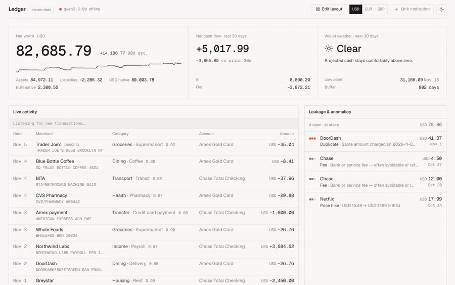
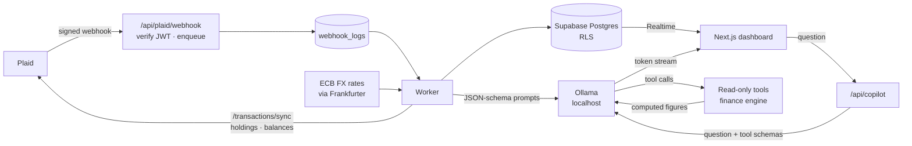
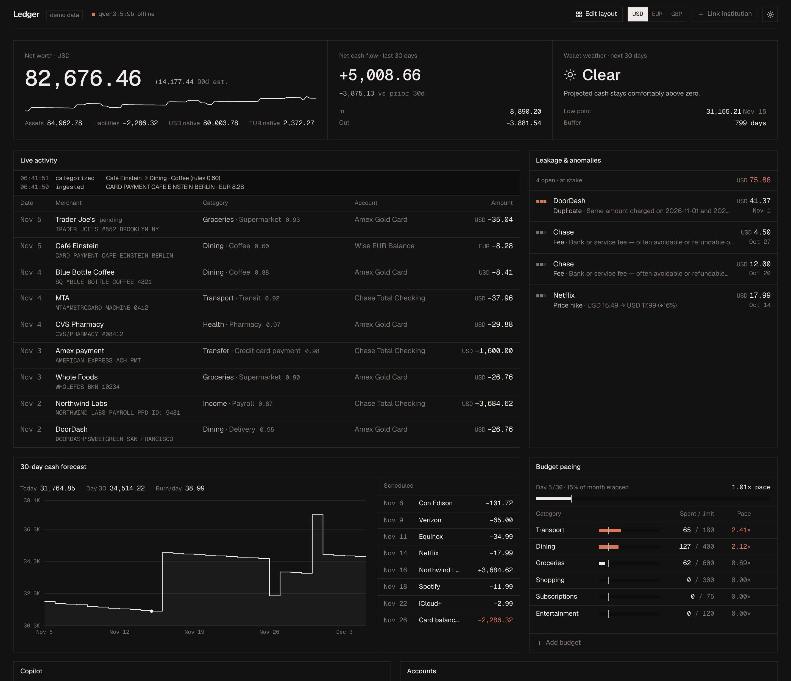
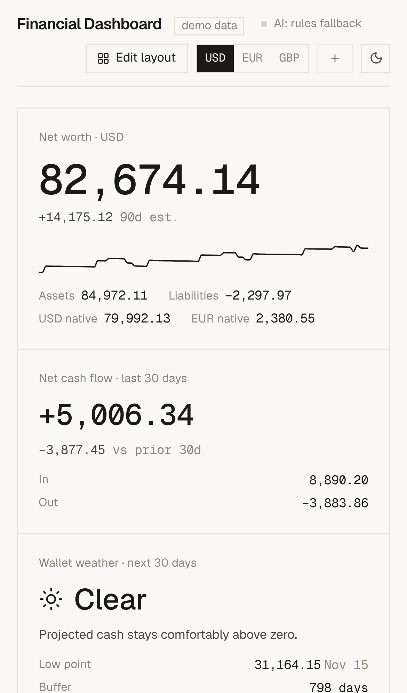
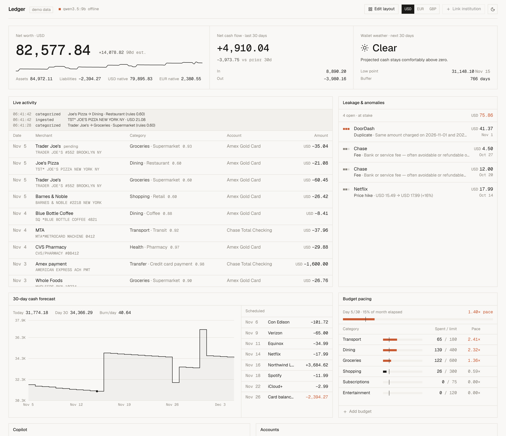
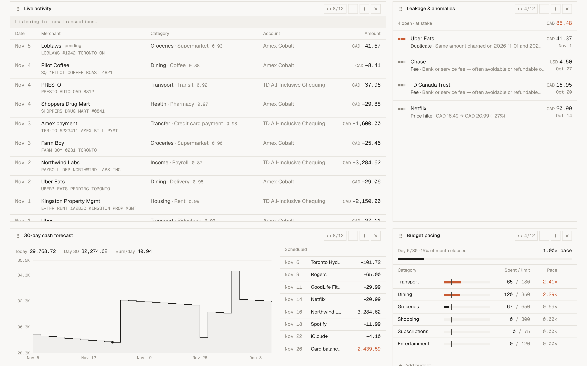

<h1>Financial Dashboard</h1>

**[▶ Live demo](https://financial-dashboard-sshower.vercel.app)** · runs on synthetic data, no sign-up

A real-time personal finance dashboard that pulls bank and brokerage data from **Plaid**, categorizes every transaction with a **local LLM (Ollama)**, flags money leaks, and forecasts the next 30 days of cash. Your financial data never goes to a cloud AI provider.

[](https://financial-dashboard-sshower.vercel.app)




<sub>Demo mode on synthetic data, sped up. New bank transactions stream in and are categorized live, net worth recalculates in USD or EUR, and panels are rearranged and resized.</sub>

## Try the demo

**Hosted:** [financial-dashboard-sshower.vercel.app](https://financial-dashboard-sshower.vercel.app) shows synthetic data with transactions streaming in live. The hosted demo has no local model, so transactions are categorized by keyword rules and the copilot is disabled. Run it locally with Ollama to see LLM categorization and the copilot.

**Locally**, with **no accounts, keys or database**, on a deterministic synthetic ledger:

```bash
git clone https://github.com/sshower111/financial-dashboard.git
cd financial-dashboard
npm install
npm run dev          # → http://localhost:3000
```

Or deploy your own copy of the demo (no environment variables needed):

[](https://vercel.com/new/clone?repository-url=https%3A%2F%2Fgithub.com%2Fsshower111%2Ffinancial-dashboard&project-name=financial-dashboard)

The demo streams a new raw bank string (`SQ *BLUE BOTTLE COFFEE 4821`) every 10–15 seconds through the same categorization pipeline the production worker uses. The seeded history includes a duplicate charge, a subscription price hike and two bank fees for the anomaly scanner to catch.

## What it does

| | |
|---|---|
| **Unified net worth** | Cash, credit, loans and brokerage in one number. Each account keeps its native currency (USD/EUR/GBP/CAD) and is converted to a switchable base currency using daily ECB reference rates. |
| **Bank & brokerage sync** | Plaid Transactions + Investments for checking, savings, credit cards, loans, IRAs and brokerage accounts, with OAuth bank support and signed webhooks. |
| **AI categorization** | A local LLM cleans merchant names (`TST* JOE'S PIZZA NEW YORK NY` → `Joe's Pizza`) and assigns category, subcategory, tags and confidence, in the background. |
| **Leak detection** | Duplicate charges, subscription price hikes, bank fees and unusual amounts, with the total at stake. |
| **Wallet weather** | A 30-day cash projection from detected paycheques, bills, card balances and spending rate, summarized as Clear / Overcast / Storm. |
| **Budget pacing** | Spend velocity against the day of the month (`1.00×` is on pace), so overspending shows up on day 5, not day 30. |
| **Separate dashboards** | Personal, Business, or any you add and name yourself, shown as tabs. Each has its own accounts, budgets and layout; nothing is mixed. Accounts linked while a tab is open land on that tab. |
| **Transfers counted once** | Card payments and moves between your own accounts are paired across accounts and excluded from spending and cash flow, so a payment isn't counted as both spending and income. |
| **Assistant** | Ask "Can I afford a $1,200 trip this month?" and the local model calls read-only tools (forecast, budget pacing, spending, recurring streams, anomalies, transaction search) backed by the finance engine, then streams an answer that shows which tools it used. Falls back to a one-shot ledger snapshot if the model can't call tools. |
| **Custom layout** | Drag, resize, add and remove panels; panels adapt to their own width. Saved per dashboard. |
| **Safe re-linking** | Linking a bank that's already connected imports only accounts that are actually new (matched by type and last 4 digits); duplicate connections can be removed from the app. |

## Engineering highlights

- **Privacy by architecture.** All LLM inference runs on `localhost` through Ollama, so raw ledgers never leave the machine. The assistant explains numbers instead of computing them: every figure it quotes comes from a server-side function.
- **Tool-calling agent with guardrails.** The assistant runs a function-calling loop over Ollama's `/api/chat`: seven read-only tools with JSON-schema parameters, each a thin wrapper over the tested finance engine. Model-supplied arguments are validated (types, enums, real calendar dates, clamped row caps); an unknown tool or bad argument goes back to the model as a structured error it can correct instead of throwing. The loop is capped at 4 tool rounds, then the model must answer without tools. Tools get only the in-memory ledger already loaded under the user's own RLS session: no database client, no network, no writes. If the model doesn't support tools or the loop fails, the route falls back to the snapshot prompt. The model call is injected, so the loop is unit-tested against a scripted fake model. Not yet run against a live Ollama model (see Known limits).
- **Non-blocking ingestion pipeline.** The Plaid webhook endpoint verifies the ES256 JWT signature and the body's SHA-256, writes a job and returns immediately. A worker drains the queue: cursor-based `/transactions/sync` (handling mutation-during-pagination restarts), balances, holdings, batched LLM categorization with JSON-schema output, then anomaly detection. Each stage has bounded retries with backoff, and the UI updates over Supabase Realtime.
- **Defense in depth on financial data.** Every table has row-level security, and Postgres **column-level grants** keep Plaid access tokens unreadable from the browser even for the token's owner. Clients can't insert bank-sourced rows, which closes a gap RLS alone leaves open: a foreign key doesn't check ownership. Verified with cross-user tests on a real Postgres engine.
- **Correct money math.** Currencies are never mixed implicitly: a missing FX rate excludes the account and surfaces a warning instead of silently assuming 1:1. Recurring-stream detection steps monthly bills by calendar month, not 30 days. All amounts render in tabular monospace.
- **Fast local categorization.** The worker checks a merchant cache first (normalized merchant strings already categorized), dedupes the rest by merchant, and sends up to 50 per structured-JSON call to a small model (`qwen2.5:1.5b` by default). Failing batches are split and retried; a merchant that keeps failing falls back to keyword rules, so the queue never stalls.
- **Tested core.** Net worth, FX bridging, pacing, recurring detection, forecasting, anomaly rules, transfer pairing, dashboard scoping and re-link matching are pure functions with unit tests (`npm test`), shared by the UI, the worker and the assistant's tools.
- **Verified end-to-end.** Driven with Playwright against a live Supabase project: a row inserted in the database appeared in a signed-in browser in about 1 second without a reload, while another user's data stayed invisible.

## Architecture



## Tech stack

**Frontend:** Next.js 16 (App Router), React 19, Tailwind CSS v4, Zustand, Recharts, Framer Motion, Lucide · **Backend:** Next.js route handlers, Node worker (`tsx`) · **Data:** Supabase (Postgres, RLS, Realtime, magic-link auth) · **Integrations:** Plaid (Transactions, Investments), Ollama (`qwen3.5:9b` for the assistant, `qwen2.5:1.5b` for categorization), Frankfurter (ECB exchange rates) · **Testing:** `node:test`, Playwright

## Connect real accounts

1. Create a Supabase project and run the SQL files in `supabase/migrations/` in order.
2. `cp .env.example .env.local`, then fill in the Supabase URL and keys and your Plaid keys (start with `PLAID_ENV=sandbox`). `PLAID_COUNTRY_CODES` defaults to `US`.
3. In Supabase → Authentication → URL Configuration, add `http://localhost:3000/auth/callback`.
4. For OAuth banks and webhooks, expose the app over HTTPS (for example an ngrok static domain). Set `PLAID_REDIRECT_URI=https://…/oauth` and `PLAID_WEBHOOK_URL=https://…/api/plaid/webhook`, and register the redirect URI in the Plaid dashboard.
5. Start local models: `ollama pull qwen3.5:9b` for the assistant and `ollama pull qwen2.5:1.5b` for categorization (override with `OLLAMA_MODEL` / `OLLAMA_CATEGORIZE_MODEL`; `llama3.2:3b` is a good middle ground).
6. Run `npm run dev` and `npm run worker`, sign in, and click **Link institution**. Sandbox login: `user_good` / `pass_good`.

```bash
npm test            # finance engine + assistant tool-calling unit tests
npm run typecheck
```

## Screenshots

<table>
<tr>
<td width="62%"></td>
<td width="38%"></td>
</tr>
</table>





---

<details>
<summary><b>Technical deep dive</b>: finance engine, assistant, database design</summary>

## Finance engine (`src/lib/finance`)

Pure functions shared by the UI, the worker and the copilot context builder, with tests in `engine.test.ts`.

| Module | What it does |
|---|---|
| `fx.ts` | Builds a rate table for the chosen base currency (direct, inverse or bridged). A missing rate throws instead of silently using 1:1. |
| `networth.ts` | Assets − liabilities with native per-currency subtotals, plus a 90-day history rolled back from transactions. Investments are held flat, so the UI labels it "est." |
| `cashflow.ts` | Trailing-30-day in/out/net vs the prior 30 days, excluding transfers. |
| `transfers.ts` | Pairs both legs of card payments and own-account transfers (equal and opposite amounts within 4 days, across accounts) and labels them `Transfer`. Runs on the full ledger before any dashboard filter. |
| `scope.ts` | Dashboards: which accounts, transactions, holdings and budgets belong to the open one. |
| `pacing.ts` | Month-to-date spend ÷ limit ÷ elapsed share of the month = velocity (1.00× is on pace). |
| `recurring.ts` | Finds weekly, biweekly, monthly, quarterly and yearly streams. Short cadences need more evidence, so a favourite restaurant doesn't count as a bill. |
| `forecast.ts` | 30-day projection: liquid cash, plus recurring income and bills, minus average discretionary burn, minus card balances (assumed due in 21 days). Wallet weather is **storm** if the projection goes below 0, **overcast** if the low point covers under 14 days of burn, otherwise **clear**. |
| `anomaly.ts` | Duplicate charges (same account, merchant and amount within 1 day), price hikes on fixed-price streams, fees, and spikes over 3.5× the merchant median. |

## Assistant

`/api/copilot` (internal name kept) runs a tool-calling loop (`src/lib/ai/agent.ts`) against Ollama's `/api/chat`. The model gets the question, recent turns and a set of function schemas; it does not get the ledger. It asks for the tools it needs, the server runs them and returns the results, and the model writes the answer from those results.

| Tool | Returns | Engine function |
|---|---|---|
| `get_financial_overview` | Net worth, account balances, holdings, trailing-30-day cash flow vs the prior 30 | `computeNetWorth`, `cashFlowDelta` |
| `get_spending_by_category` | Spending per category plus income / spending totals for a period or date range | `spendByCategory`, `cashFlow` |
| `get_cash_forecast` | 30-day projection, low point, shortfall date, wallet weather, upcoming income and bills | `forecastCash` |
| `get_budget_pacing` | Spent, limit, velocity, projected month-end and status per budget | `budgetPacing` |
| `get_recurring_streams` | Paycheques, bills and subscriptions with cadence, amount and next date | `detectRecurring` |
| `get_anomalies` | Duplicate charges, price hikes, fees and unusual amounts from the last 45 days | `detectAnomalies` |
| `search_transactions` | Transactions by merchant, category, date range or minimum size (max 50 rows) with pre-summed totals | filter + `convert` |

How the loop works:

1. **Schemas** (`src/lib/ai/tools.ts`). Each tool is an OpenAI-style function definition. Date ranges take a named `period` (`this_month`, `last_month`, …) resolved on the server, so the model doesn't do calendar arithmetic.
2. **Validate, then execute.** Arguments from the model are untrusted input: types, enums and dates are checked, row limits are clamped, unknown keys are dropped. An unknown tool name or invalid argument returns `{ ok: false, error: { code, message } }` to the model, which can retry. Nothing throws.
3. **Bounded.** At most 4 tool rounds and 6 calls per round. After that the model is called once more with no tools and told to answer from what it has.
4. **Read-only and scoped.** Tools receive the in-memory ledger the route loaded with the signed-in user's own session (RLS), already narrowed to the open dashboard. They have no database client and no write path, and the service role key is not involved.
5. **Streaming.** The answer streams as plain text. Control lines in the stream (`src/lib/ai/wire.ts`) tell the UI which tools ran, shown next to the answer as "used: cash forecast, budget pacing".
6. **Fallback.** If the model doesn't support tools, or the loop fails at any point, the route answers the old way: a compact JSON snapshot (weekly burn by category, pacing, forecast, recurring streams, anomalies, the last 45 days of transactions) in one prompt. `COPILOT_TOOLS=off` forces this path.

In both paths the figures are computed by the finance engine, so the model explains them rather than doing arithmetic. The model call is injected into the loop, and `src/lib/ai/agent.test.ts` drives it with a scripted fake model: validation, every tool against the demo ledger, the round cap, error recovery and the fallback.

## Database & security

`supabase/migrations/0001_init.sql`:

- Added `institutions.plaid_item_id`, because Plaid webhooks identify items, not institutions.
- **Plaid access tokens never reach the browser**: column-level grants hide `access_token`, and only the service role can write institutions, accounts, holdings or new transactions. Clients can recategorize transactions and rename or deactivate accounts.
- `webhook_logs` has RLS with no policies, so only the service role can use it. It also gained `error` and `attempts` columns to work as the job queue.
- New tables: `budgets`, `user_settings` (base currency) and `fx_rates` (USD-based ECB reference rates from Frankfurter, refreshed twice a day).
- Policies are `to authenticated` with `(select auth.uid())`. Added indexes on the hot paths and enabled Realtime on `transactions`.

Later migrations (RLS policies unchanged in all of them):

- `0003`: `accounts.owner_label`, the dashboard an account belongs to. Clients can update only this column plus `is_active` and `name`.
- `0004`: dashboards. Names live in `user_settings.dashboards`; `budgets` and `dashboard_layouts` get a `dashboard` column and per-dashboard unique keys.
- `0005`: `accounts.mask` (last 4 digits, written only by the service role), used to detect re-linking the same bank.

## Layout

The dashboard is a 12-column CSS grid driven by a JSON `layout_config` of `[{ i, w, h }]`. In **Edit layout** you can drag panels to reorder, change width (3/4/6/8/12) and height (1–4 rows), and remove or add widgets. The layout is saved to `dashboard_layouts`, or to localStorage in demo mode, and is validated on load.

## Known limits & roadmap

- The assistant's tool-calling loop is covered by unit tests with a scripted fake model, but has not yet been run against a live Ollama model. How reliably a given local model picks tools and arguments is untested; small models may call the wrong tool or none.
- Run a single worker: job claiming isn't safe across concurrent workers. The merchant cache is in memory and rebuilt every 15 minutes.
- Item errors (`ITEM_LOGIN_REQUIRED`) are logged, but Plaid Link update mode isn't wired up yet.
- The first sync after linking retries with backoff (about 15 min) until Plaid finishes its initial pull. After that, new data arrives only through webhooks.
- Net-worth history doesn't include investment price changes.
- Encrypt Plaid access tokens at rest (Supabase Vault).
- Plaid Link update mode for re-authenticating expired items.
- Removing a bank deletes its stored history; re-linking re-imports what Plaid provides (up to 730 days requested).
- Sync progress shows the Plaid import as a step, not a percentage: Plaid doesn't report a total up front.

</details>
